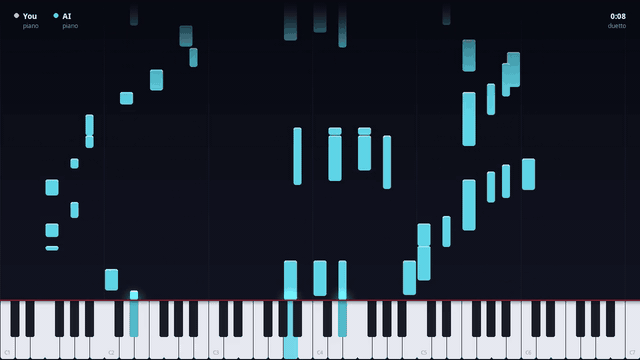
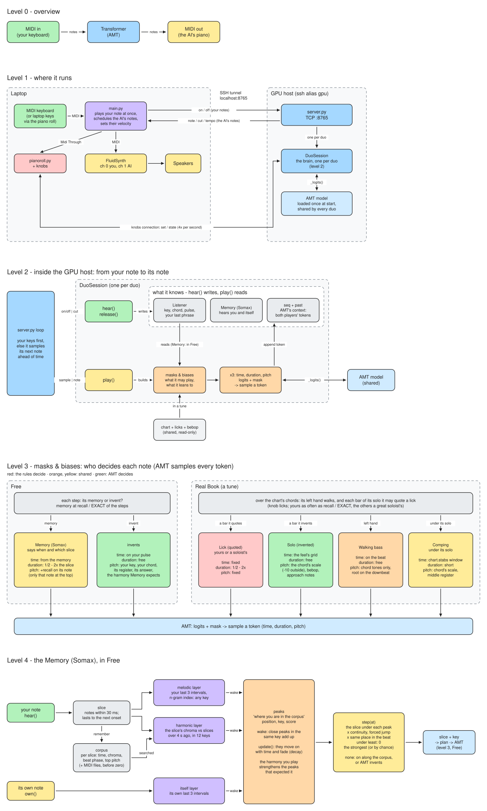

# duetto

[](https://github.com/RiccardoCataldi/duetto/actions/workflows/tests.yml) [](LICENSE)



▶ **[With sound: a blues in F at 190 bpm](samples/duo/blues-190.mp4)**, the model alone, three choruses.

Play a MIDI keyboard and a transformer plays a second piano with you, in real time. Pick a tune from a Real Book and it plays it with you: walking bass, comping, solos. It listens like a partner: it comps while you play, solos when you rest, answers your phrases and quotes them back.

The model is the pretrained [Anticipatory Music Transformer](https://github.com/jthickstun/anticipation) (AMT), on a PC with a GPU; the laptop handles the keyboard, the sound and the piano roll.

## Run it

```bash
./run_duet.sh                                                      # AMT medium on the GPU host
SERVER_ARGS="--model ~/models/music-large-800k" ./run_duet.sh      # the large model
DUET_HOST=other-pc ./run_duet.sh                                   # another GPU host
```

It copies the model's code to the GPU host, starts the server there, an SSH tunnel, FluidSynth, `main.py` and the piano roll. Closing the piano roll stops the duo and saves it in `generated/`.

No MIDI keyboard? The laptop's keys play, as in Ableton Live: `A W S E D F T G Y H U J K O L P` from C, `Z`/`X` octave down/up, `C`/`V` softer/louder.

## Playing a tune

Pick a tune in **Play** and its page appears. **Play** (or the space bar) counts it in, **Stop** silences it; it never starts by itself. The **Metronome** is beside it. Choose its **Part**:

| Part | It plays |
| --- | --- |
| **Comps** | a walking bass and chords on each chord's scale, for you to solo |
| **Solos** | a bebop line over the changes, for you to comp, quoting the great soloists (the `licks` knob) |
| **Duet** | comps while you play, solos when you rest |
| **Trade fours** | four bars yours, four bars its own |

It also quotes **you**: each phrase you play is filed under its chords and comes back wherever those chords return, in any key (*memory*: how often; *dialogue*: how much it prefers your last one). Between two phrases it quotes it may add a pickup into the next (the `pickup` knob). A phrase it quotes is a whole one, from where its soloist began it, upbeat and all, to where they ended it; its line waits for it, it begins near where the line left off, and its notes on the beat are fitted to the tune's chords. Now and then it plays the last one again to develop it: over the next chords, a beat later, its first half or upside down (the `vary` knob). Its solo builds over each chorus: eighths, short phrases and low at first, faster, longer and higher three quarters through (the `arc` knob). Hold a chord that is not the tune's and it follows your reharmonisation (*key follow*: how soon).

## The controls

| Tab | What is there |
| --- | --- |
| **Play** | the Tune, Play/Stop and the Metronome; the Part; the Character; the octaves |
| **Sound** | both pianos in FluidSynth: instrument, volume, pan, envelope, reverb, delay |
| **Advanced** (F2) | every knob of the model (`KNOBS` in [duo.py](music_transformer/duo.py)) |

The **Character** is nine controls: density, harmony, role, dialogue, groove, risk, focus, memory, key follow. Hover one to read what it does.

Keys: `Space` play/stop the tune, `F` (or `F11`) fullscreen, `K` (or `Tab`) hide the panel, `F2` Advanced, `Esc` quit.

## Add a tune

Charts are text files in [music_transformer/charts/](music_transformer/charts/) (Autumn Leaves, All the Things You Are, Misty, Ornithology, a blues in F). Bars between `|`, `%` repeats the bar before, chords sharing a bar split it; restart the server:

```
title: Autumn Leaves
key: G minor
bpm: 120
Cm7 | F7 | Bbmaj7 | Ebmaj7 | Am7b5 | D7 | Gm6 | % |
```

Eighths are swung unless the chart says `feel: straight`.

## How it works



The diagram's source is [docs/diagrams/duetto.excalidraw](docs/diagrams/duetto.excalidraw): open it in [Excalidraw](https://excalidraw.com) or VS Code's Excalidraw extension.

Your notes and the model's are one sequence AMT continues, a note at a time (when, how long, which). Before each sample `duo.py` masks what may not be (a hand that must wait, a pitch out of register) and biases what should be (the chord's tones, the next note of a phrase it quotes). The server keeps a second of music sampled ahead and resamples it when you play. On a 3080 Ti a note takes ~12 ms (medium) or ~18 ms (large).

The words used across code and panel are defined in [CONTEXT.md](CONTEXT.md).

<details>
<summary>Setup and on one machine</summary>

- **GPU host**: the repo in `~/Ai-Duet`, a venv with `pip install -r requirements.txt`, the model in `~/models/music-medium-800k` (and optionally `music-large-800k`), `ssh gpu` (an alias in `~/.ssh/config`, or set `DUET_HOST`) working with a key.
- **Laptop**: FluidSynth with FluidR3_GM, and a venv with `pip install mido python-rtmidi pygame imageio-ffmpeg`. A sampled grand at `~/sf2/SalamanderGrandPiano.sf2` ([Salamander](https://freepats.zenvoid.org/Piano/acoustic-grand-piano.html), or `SOUNDFONT=path/to.sf2`) plays over FluidR3_GM.
- **On one machine**: `python -m music_transformer.server` (it downloads the model and picks CUDA, Apple Silicon or the CPU), then FluidSynth (`fluidsynth -a pipewire -m alsa_seq -i -s /usr/share/sounds/sf2/FluidR3_GM.sf2 &` and `aconnect "Midi Through" "FLUID Synth"`), `python main.py` and `python pianoroll.py`.
- **Tests**: `python -m unittest discover -s tests` (the model's need torch and `anticipation`).
- **Logs**: `~/amt_server.log` on the GPU host; `duet.log`, `fluidsynth.log`, `pianoroll.log` in `/tmp` on the laptop.

</details>

## License

[PolyForm Noncommercial 1.0.0](LICENSE): free for anything noncommercial. The model is the [Anticipatory Music Transformer](https://github.com/jthickstun/anticipation), under its own license. The quoted phrases ([licks.json.gz](music_transformer/licks.json.gz)) and the bebop statistics come from the [Weimar Jazz Database](https://jazzomat.hfm-weimar.de), under the ODbL.
