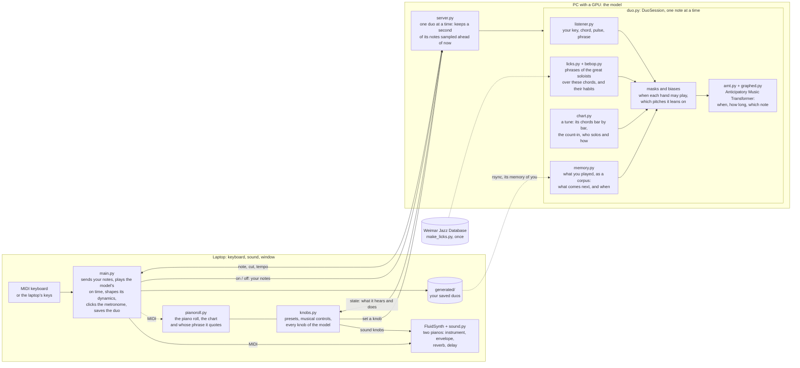

# duetto

[](https://github.com/RiccardoCataldi/duetto/actions/workflows/tests.yml) [](LICENSE)


Play a MIDI keyboard and a transformer plays a second piano with you, in real time. It listens like a partner: your key, the chord you play, your pulse, your phrases. It comps while you play and takes the melody when you rest.

▶ **[Watch a full improvisation on YouTube](https://www.youtube.com/watch?v=0qvRMhN8qa4)**

https://github.com/user-attachments/assets/41a18857-2421-4c9a-b8b0-83cfdad1ff84

The model is the pretrained [Anticipatory Music Transformer](https://github.com/jthickstun/anticipation) (Lakh MIDI), running on a PC with a GPU; the laptop handles MIDI, sound and the piano roll.

https://github.com/user-attachments/assets/bd7c846d-0ae0-4ff4-a644-22b97c01049c

Above: you play low chords, the model improvises over them (the **it solos** preset). Files in [samples/duo](samples/duo).

## How it works

Two machines: the laptop has the keyboard, the sound and the window; the model runs where the GPU is, behind an SSH tunnel. They talk over one TCP connection, a line of text per message ([music_transformer/server.py](music_transformer/server.py) lists them).



| Block | What it does |
| --- | --- |
| [main.py](main.py) | Reads your keyboard and sends each key the moment you press it. Plays the model's notes when they are due (one that arrives too late is skipped, not played out of time), a little softer than you play and shaped as a pianist would; clicks the metronome; records the duo and saves it in `generated/`. |
| FluidSynth, [sound.py](sound.py) | The sound of both pianos on the laptop: instrument, volume, envelope, reverb, and a delay played as MIDI echoes. |
| [pianoroll.py](pianoroll.py) | The window: your notes and the model's rising from the keyboard, the tune's chart with the bar you are in, the name of the soloist it is quoting. Without a MIDI keyboard, the laptop's keys play. |
| [knobs.py](knobs.py) | The panel beside it: presets and a few musical controls, each turning some of the model's knobs; it shows what the model hears and does, four times a second. |
| [server.py](music_transformer/server.py) | Runs next to the model. Hands your notes to the session, asks it for notes until a second of music is sampled ahead of now, and sends them; tells the laptop to drop (`cut`) those not yet sounded when your playing made the model sample them again. |
| [duo.py](music_transformer/duo.py) | The duo itself. Your notes and its own are one sequence the model continues; each of its notes is three samples: when, how long, which. Before each sample it masks what may not be (a hand that must wait, a pitch out of its register) and adds a bias to what should be (the chord's tones, your key, the next note of a phrase it quotes). |
| [listener.py](music_transformer/listener.py) | Hears you as a partner does: your key and when you modulate, the chord under your hands, your pulse, your last phrase. Over a tune, the chart's chords take the place of yours. |
| [memory.py](music_transformer/memory.py) | Your playing, now and in your saved duos, as a corpus in the manner of Somax2: what you play wakes places in it, and the strongest says what comes next. |
| [chart.py](music_transformer/chart.py) | A tune from `charts/`: its chords bar by bar, tempo and count-in; who solos now (its `part`), how it plays the changes and divides the beat for the next two bars, where it comps under its own solo. |
| [licks.py](music_transformer/licks.py), [bebop.py](music_transformer/bebop.py) | The phrases of one to four bars it quotes, filed under the chords they were played over, and how often bebop soloists play each step over each kind of chord. Both come from the Weimar Jazz Database ([make_licks.py](music_transformer/make_licks.py) makes the first). |
| [amt.py](music_transformer/amt.py), [graphed.py](music_transformer/graphed.py) | The pretrained Anticipatory Music Transformer, fed one token at a time with its cache kept; `graphed.py` replays that step as a CUDA graph, which is what makes a note fast enough. |

Over a tune its hands are three: a walking bass that owes a note on every beat, a right hand that solos or comps as its `part` says, and, under its own solo, a hand that comps a chord now and then.

## Its memory

What you play becomes a corpus, in the manner of [Somax2](https://github.com/DYCI2/Somax2) (written anew from its published model, in [music_transformer/memory.py](music_transformer/memory.py)). Your notes wake peaks in that corpus, on three layers: your line, your harmony, its own line. Peaks move on with time, fade, and add up when they agree, in any key, and the strongest says what comes next and when. AMT plays it, as closely as `recall` asks: at 0 it only invents, at the top it quotes you. It also knows the harmony it expects next.

Silence comes the same way: the rests you play are in the corpus; `silence` leaves slices out; `timeout` is how long it plays on after your last note; with `sparse` on it plays only when it remembers. With nothing to remember it invents, in phrases of about `phrase` notes with a `breath` between them.

`./run_duet.sh` gives it your saved duos in `generated/` (your track of each); by hand, `python -m music_transformer.server --corpus generated`.

## Run it

```bash
./run_duet.sh                      # on the laptop
```

`run_duet.sh` restarts everything: it copies the model's code to the PC with the GPU (`DUET_HOST`, raichu by default), then starts the model server there, the SSH tunnel, FluidSynth, `main.py` on the keyboard and the piano roll. Closing the piano roll stops the duo and saves it in `generated/`.

### On one machine

Everything runs on one Linux laptop too. The server downloads the model and picks CUDA, Apple Silicon or the CPU (with the smaller model on the CPU):

```bash
python -m venv .venv && .venv/bin/pip install -r requirements.txt
.venv/bin/python -m music_transformer.server                    # terminal 1: the model
fluidsynth -a pipewire -m alsa_seq -i -s /usr/share/sounds/sf2/FluidR3_GM.sf2 &
aconnect "Midi Through" "FLUID Synth"                            # the duo's sound
.venv/bin/python main.py                                         # terminal 2: pick your keyboard (Ctrl+C stops and saves)
.venv/bin/python pianoroll.py                                    # terminal 3: the piano roll and the knobs
```

No MIDI keyboard? Press Enter in `main.py` instead of picking one, and the laptop's keyboard plays in the piano roll, as in Ableton Live (A W S E D F T G Y H U J K O L P from C, Z and X an octave down and up, C and V softer and louder).

<details>
<summary>Setup</summary>

- **PC with a GPU**: the repo in `~/Ai-Duet` with a venv (`pip install -r requirements.txt`), the model as safetensors in `~/models/music-medium-800k`, and `ssh raichu` (or your `DUET_HOST`) working with a key.
- **Laptop**: FluidSynth with FluidR3_GM, and a venv with `pip install mido python-rtmidi pygame imageio-ffmpeg`. A sampled grand at `~/sf2/SalamanderGrandPiano.sf2` ([Salamander Grand Piano](https://freepats.zenvoid.org/Piano/acoustic-grand-piano.html), or another with `SOUNDFONT=path/to.sf2 ./run_duet.sh`) plays the piano over FluidR3_GM's.
- **Code changes**: `./run_duet.sh` copies `music_transformer/` and `tests/` to the PC. The model's tests need torch: run `python -m unittest tests.test_duo_session tests.test_graphed` there.
- **Speed**: on CUDA the model feeds each token through a CUDA graph ([music_transformer/graphed.py](music_transformer/graphed.py)), the same GPT-2 about three times sooner than in eager mode.
- **Logs**: `~/amt_server.log` on the PC; `duet.log`, `fluidsynth.log`, `pianoroll.log` in `/tmp` on the laptop.

</details>

## Piano roll and knobs


The top of the piano roll says what the model hears (key, chord, tempo) and what it is doing. Keys: F fullscreen, K show or hide the controls, the laptop's keyboard is a piano while `main.py` plays (F and K are then its keys: F11 and Tab stand in for them), Esc close.

Controls are sliders (drag them; hold Shift to drag finely) and steppers (click the arrows). The arrow keys or Ctrl and the wheel over a control turn it; the wheel alone scrolls the panel. A double click resets a control, and the bottom of the panel says what the control under the mouse does. A control is dimmed while what it shapes is not happening.

- **AI mind**
  - Presets: **duet**, **call & response**, **it comps** (it plays the harmony, you improvise), **it solos** (you play the harmony, it improvises), **free**
  - Musical controls: density, harmony, role, dialogue, groove, risk, focus, memory, key follow
  - Range: `lowest`, `highest` octave
  - Scale: `root` and `scale` force it into a scale (C major, D harmonic minor, F minor pentatonic...) instead of your key
  - Tempo: `bpm` fixes its tempo instead of following yours, `metronome` clicks it
- **Your sound**, **AI sound**: instrument, volume, pan, envelope, reverb and delay, in FluidSynth
- **Advanced**: every knob of the model, described in `KNOBS` in [music_transformer/duo.py](music_transformer/duo.py), where the defaults are too

Knobs and sound are kept in `~/.config/ai-duet/`.

## Play a tune from a chart

A jazz buddy to practise with: pick a tune in **Play along** (AI mind tab), as from a Real Book, and the model plays over its chords bar by bar, round and round. The section's title says which tune is on; the piano roll shows it as a page of a Real Book, its bars in rows, the one being played lit with its beats.

- `chart`: the tune. It begins after a bar of count-in (the beats to go are shown, large); `bpm` fixes another tempo than the chart's (the tune carries on from where it is) and `metronome` turns the click off. Its eighths are swung unless the chart says `feel: straight`.
- `part`, which the playing styles set, and which by itself says what its hands do, whatever the texture knobs (its octaves still hold): comping, chords of three notes or more from F3 to E5 over a walking bass; soloing, a line of single notes from middle C up.
  - **comps** (it comps): a rhythm section for your solo. It starts by itself when the count-in ends: chords on the chords' scales (C dorian over Cm7 in Bb, D7 with its b9 and b13 in G minor: `CHORD_SCALES` in [music_transformer/listener.py](music_transformer/listener.py)) over a walking bass, a note a beat: the root where a bar or a chord begins, a semitone from the next chord's root on the beat before it, mostly by step in between.
  - **solos** (it solos): it improvises for you to comp, and starts by itself too. It **quotes** the great soloists, as much as the `licks` knob says (Play along; 0.4 at first): a phrase one of them played over these same chords, note for note, in the key of the tune and swung as the tune is; the piano roll says whose phrase it is. At 0 it plays its own lines only; at the top one phrase follows another, and nine notes of its solo in ten and more are theirs; in between, that share of its bars is quoted and the model plays the others. A phrase is tied to its chords and not to the form of a tune, and it is one soloist's from end to end: at each bar it comes to with no phrase under way, it looks at the chords of the eight bars that begin there and takes a phrase someone played whole over the first four (a ii-V-I-IV, a I-vi-ii-V, four bars of a blues...), three (a ii-V-I), two or one, wherever in the tune they fall and in any key: of the lengths that were played, the one that leaves the bars after it to the fewest phrases, so that the next begins where a progression does and not in the middle of one. It plays it through, with no breath of its own, and for the next it stays with the same soloist when they played those chords too (`LONGER` and `SAME` in [music_transformer/licks.py](music_transformer/licks.py) say how often). Over the five tunes here, three bars in four of what it quotes and more are in phrases of three or four bars. The phrases are 55,067 licks of one to four bars from 395 solos by 76 players of the [Weimar Jazz Database](https://jazzomat.hfm-weimar.de), from Louis Armstrong and Lester Young to Charlie Parker, Miles Davis, John Coltrane, Sonny Rollins, Clifford Brown and Michael Brecker, filed under their chords and free of any key, in [music_transformer/licks.json.gz](music_transformer/licks.json.gz) (made by [make_licks.py](music_transformer/make_licks.py); like the database, under the ODbL). Its own lines change their way every two bars: as bebop players do (each note over the chord as often as they play it, on the beat and off it, and the next chord's notes in the half beat before it: counted over 132 bebop and hard bop solos of the [Weimar Jazz Database](https://jazzomat.hfm-weimar.de), Charlie Parker's among them, in [music_transformer/bebop.py](music_transformer/bebop.py)), or the chord's scale, its arpeggio, the pentatonic on its root, the blues scale of the tune's key or its major pentatonic, with chromatic approaches to the chord's tones. Its line moves as theirs do, mostly by step, and its rhythm changes every two bars as well: swung eighths, or a run of triplets, sixteenths or thirty-seconds, or out of time (`WAYS` and `FEELS` in [music_transformer/chart.py](music_transformer/chart.py) say how often each).
  - **duet**: it waits for your first note, comps while you play and solos when you rest. Under its own solo, over its walking bass (here and when it trades fours), it comps too, as a pianist's left hand does: a short chord of three notes from E3 to A4, about one a bar, on one, on the "and" of two, both, pushing the next bar, or none (`STABS` in [music_transformer/chart.py](music_transformer/chart.py) says how often each). Over its bass its right hand is never silent for longer than `max_rest` either: left to choose, the model hears a bass alone and goes on with a bass alone.
  - **trades** (trade fours): four bars of your solo while it comps, then four of its own.

While a tune is on it comes before a scale you force.

Charts are text files in [music_transformer/charts/](music_transformer/charts/): Autumn Leaves, All the Things You Are, Misty, Ornithology and a blues in F are there. To add one, write its bars between `|` (`%` repeats the bar before, two chords share a bar), with its title, key and tempo on top, and start the server again:

```
title: Autumn Leaves
key: G minor
bpm: 120
Cm7 | F7 | Bbmaj7 | Ebmaj7 | Am7b5 | D7 | Gm6 | % |
```

## License

[PolyForm Noncommercial 1.0.0](LICENSE): use it, change it and share it freely for anything noncommercial (personal, study, research, education, hobby). Commercial use is not allowed. The model itself is the [Anticipatory Music Transformer](https://github.com/jthickstun/anticipation), under its own license.
