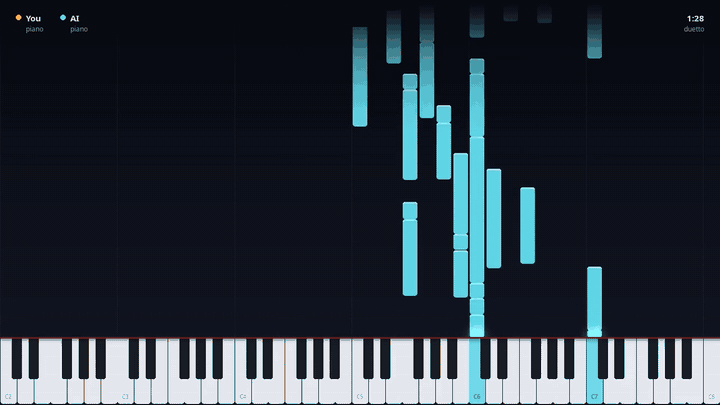

# duetto

[](https://github.com/RiccardoCataldi/duetto/actions/workflows/tests.yml) [](LICENSE)



Play a MIDI keyboard and a transformer plays a second piano with you, in real time. It listens like a partner: your key, the chord you play, your pulse, your phrases. It comps while you play and takes the melody when you rest.

▶ **[Watch a full improvisation on YouTube](https://www.youtube.com/watch?v=0qvRMhN8qa4)**

https://github.com/user-attachments/assets/41a18857-2421-4c9a-b8b0-83cfdad1ff84

The model is the pretrained [Anticipatory Music Transformer](https://github.com/jthickstun/anticipation) (Lakh MIDI), running on a Jetson; the laptop handles MIDI, sound and the piano roll.

https://github.com/user-attachments/assets/bd7c846d-0ae0-4ff4-a644-22b97c01049c

Above: you play low chords, the model improvises over them (the **it solos** preset). Files in [samples/duo](samples/duo).

## Its memory

What you play becomes a corpus, in the manner of [Somax2](https://github.com/DYCI2/Somax2) (written anew from its published model, in [music_transformer/memory.py](music_transformer/memory.py)). Your notes wake peaks in that corpus, on three layers: your line, your harmony, its own line. Peaks move on with time, fade, and add up when they agree, in any key, and the strongest says what comes next and when. AMT plays it, as closely as `recall` asks: at 0 it only invents, at the top it quotes you. It also knows the harmony it expects next.

Silence comes the same way: the rests you play are in the corpus; `silence` leaves slices out; `timeout` is how long it plays on after your last note; with `sparse` on it plays only when it remembers. With nothing to remember it invents, in phrases of about `phrase` notes with a `breath` between them.

`./run_duet.sh` gives it your saved duos in `generated/` (your track of each); by hand, `python -m music_transformer.server --corpus generated`.

## Run it

```bash
./run_duet.sh                      # on the laptop
```

`run_duet.sh` restarts everything: it copies the model's code to the Jetson and maxes its clocks, then starts the model server there, the SSH tunnel, FluidSynth, `main.py` on the keyboard and the piano roll. Closing the piano roll stops the duo and saves it in `generated/`.

### Without a Jetson

Everything runs on one Linux laptop too. The server downloads the model and picks CUDA, Apple Silicon or the CPU (with the smaller model on the CPU):

```bash
python -m venv .venv && .venv/bin/pip install -r requirements.txt
.venv/bin/python -m music_transformer.server                    # terminal 1: the model
fluidsynth -a pipewire -m alsa_seq -i -s /usr/share/sounds/sf2/FluidR3_GM.sf2 &
aconnect "Midi Through" "FLUID Synth"                            # the duo's sound
.venv/bin/python main.py                                         # terminal 2: pick your keyboard (Ctrl+C stops and saves)
.venv/bin/python pianoroll.py                                    # terminal 3: the piano roll and the knobs
```

No MIDI keyboard? Press Enter in `main.py` instead of picking one, then M in the piano roll: the laptop's keyboard plays, as in Ableton Live (A W S E D F T G Y H U J K O L P from C, Z and X an octave down and up, C and V softer and louder).

<details>
<summary>Setup</summary>

- **Jetson** (Orin Nano, JetPack 6): the repo in `~/Ai-Duet` with a venv made with `--system-site-packages` (NVIDIA's torch), the model as safetensors in `~/models/music-medium-800k`, power mode MAXN_SUPER, and `ssh jetson` working with a key. Then once `ssh -t jetson sudo bash Ai-Duet/jetson_setup.sh`: it lets `run_duet.sh` max the clocks, and frees the memory the model needs by running without a desktop and turning off the services the duo does not use (the script says how to undo it).
- **Laptop**: FluidSynth with FluidR3_GM, and a venv with `pip install mido python-rtmidi pygame imageio-ffmpeg`. A sampled grand at `~/sf2/SalamanderGrandPiano.sf2` ([Salamander Grand Piano](https://freepats.zenvoid.org/Piano/acoustic-grand-piano.html), or another with `SOUNDFONT=path/to.sf2 ./run_duet.sh`) plays the piano over FluidR3_GM's.
- **Code changes**: `./run_duet.sh` copies `music_transformer/`, `tests/` and `jetson_setup.sh` to the Jetson. The model's tests need torch: run `python -m unittest tests.test_duo_session tests.test_jam tests.test_graphed` there.
- **Speed**: on CUDA the model feeds each token through a CUDA graph ([music_transformer/graphed.py](music_transformer/graphed.py)), the same GPT-2 about three times sooner than in eager mode.
- **Logs**: `~/amt_server.log` on the Jetson; `duet.log`, `fluidsynth.log`, `pianoroll.log` in `/tmp` on the laptop.

</details>

## Piano roll and knobs


The top of the piano roll says what the model hears (key, chord, tempo) and what it is doing. Keys: F fullscreen, K show or hide the controls, M play the laptop's keyboard as a piano (F and K are then its keys), Esc close.

Controls are sliders (drag them; hold Shift to drag finely) and steppers (click the arrows). The arrow keys or Ctrl and the wheel over a control turn it; the wheel alone scrolls the panel. A double click resets a control, and the bottom of the panel says what the control under the mouse does. A control is dimmed while what it shapes is not happening.

- **AI mind**
  - Presets: **duet**, **call & response**, **it comps** (it plays the harmony, you improvise), **it solos** (you play the harmony, it improvises), **free**; and the ways of MIT's [jam_bot](https://zenodo.org/records/17811478), the model left free and started again from your last notes: **trade** (you take turns of two bars), **follow me** (after each of your gestures), **on cue** (when you play a key under C2), in [music_transformer/jam.py](music_transformer/jam.py)
  - Musical controls: density, harmony, role, dialogue, groove, risk, focus, memory, key follow
  - Range: `lowest`, `highest` octave
  - Scale: `root` and `scale` force it into a scale (C major, D harmonic minor, F minor pentatonic...) instead of your key
  - Tempo: `bpm` fixes its tempo instead of following yours, `metronome` clicks it
- **Your sound**, **AI sound**: instrument, volume, pan, envelope, reverb and delay, in FluidSynth
- **Advanced**: every knob of the model, described in `KNOBS` in [music_transformer/duo.py](music_transformer/duo.py), where the defaults are too

Knobs and sound are kept in `~/.config/ai-duet/`.

## Duo with Aria on a PC with a GPU

[Aria](https://github.com/EleutherAI/aria) (EleutherAI) is a model of expressive solo piano: about 1B parameters, trained on ~60k hours of piano recordings transcribed to MIDI. Where AMT plays one line and leaves the dynamics to `main.py`, Aria plays both its hands and says how hard it strikes each key; it hears your notes and its own as one performance, four hands on one keyboard, and is told the music is jazz (`--genre`). It needs an NVIDIA GPU with ~4 GB free (an RTX 3080 Ti is plenty); the Jetson Orin Nano is too slow for it.

**On the PC, once** (Python 3.11+, the repo in `~/Ai-Duet`, `ssh pc` working from the laptop with a key):
```bash
cd ~/Ai-Duet && python3 -m venv .venv && . .venv/bin/activate
pip install torch safetensors numpy                               # torch with CUDA (driver CUDA 12.8: --index-url https://download.pytorch.org/whl/cu128)
pip install git+https://github.com/EleutherAI/aria-utils.git
git clone https://github.com/EleutherAI/aria ~/aria && pip install --no-deps -e ~/aria   # --no-deps: mlx is for Macs
mkdir -p ~/models && wget -O ~/models/aria-medium-gen.safetensors \
  https://huggingface.co/loubb/aria-medium-base/resolve/main/model-gen.safetensors
```

**Every time:** from the laptop,
```bash
DUET_HOST=pc SERVER_ARGS="--engine aria --checkpoint ~/models/aria-medium-gen.safetensors" ./run_duet.sh
```
Over a VPN, the network's delay adds to the model's: the model plays `LOOKAHEAD` (1 s) ahead and a new note of its sounds no sooner than `MARGIN` (150 ms); if `ping pc` is above ~60 ms or jumps around, raise `MARGIN` in `music_transformer/aria_duo.py` and `LATE_S` in `main.py`. The server log says, when a duo ends, how fast it was: if its first note after yours goes out well within `MARGIN`, `MARGIN` can come down and it answers you sooner.

**Its knobs** (`KNOBS` in `music_transformer/aria_duo.py`, in the **Advanced** tab): Aria is a pianist already, so they nudge it less than AMT's and there are no rules against loops: `chord` and `solo_chord` (most notes it starts at once while you play, and when you leave it room: low, it plays lines and arpeggios rather than blocks), `space` and `min_step` (time between its onsets while you play and when you rest), `out_of_key`, `chord_tone`, `tension`, `apart` and `lead` (where it plays against you, as a second pianist: while you play it keeps apart from your hands, the keys you played in the last 2 s or that still sound, and, once your top hand reaches C5, from over your melody, so it comps between your hands or under them, less firmly when that leaves it under 12 free keys; when you rest it takes the melody, up from an octave under the middle of your right hand, C5 to G5; neither changes how much it plays, only where; `role` turns both), `grid` (at its highest, 20, its own expressive timing), `max_rest`, and what makes it a partner in a jam: `busy` (it plays about so many notes or chords for each one of yours, counted over 8 s: sparse when you are, busier when you are), `phrase` and `breath` (it plays in phrases of about so many notes or chords and breathes between them), `commit` (how far ahead its plan stands when you play, unless your note puts it out of your key), `follow` (it plays as loud as you do, a little under you while you play), `answer` and `echo` (when your phrase ends it answers it with your intervals; `dialogue` turns them and `follow`), `timeout` (it stops a while after you do, and waits for you), `wait` (above 0 you take turns: it plays only once you have rested that long, and gives way as you play again), `root`, `scale`, `bpm` and `metronome` as with AMT, `temperature` and `min_p` (how adventurous, as Aria's authors sample it), `lowest` and `highest`. The **AI mind** controls turn those it has.

**Its tests** need torch and aria-utils, not the model: `python -m unittest tests.test_aria_duo tests.test_server`.


## License

[PolyForm Noncommercial 1.0.0](LICENSE): use it, change it and share it freely for anything noncommercial (personal, study, research, education, hobby). Commercial use is not allowed. The model itself is the [Anticipatory Music Transformer](https://github.com/jthickstun/anticipation), under its own license.
