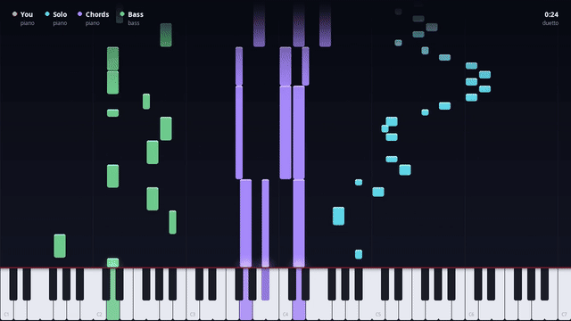
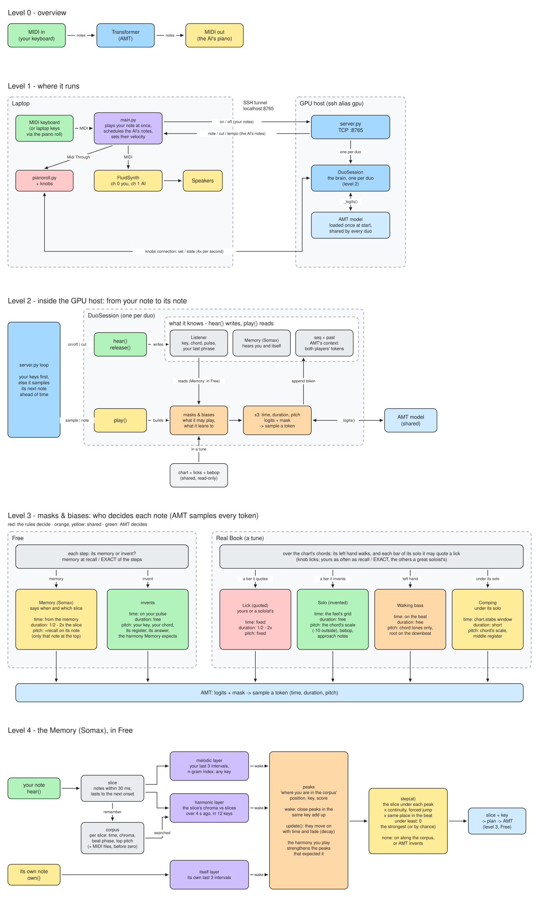

# duetto

[](https://github.com/RiccardoCataldi/duetto/actions/workflows/tests.yml) [](LICENSE)

[](https://youtu.be/8zIAzVY8O6w)

▶ **[Watch it with sound on YouTube](https://youtu.be/8zIAzVY8O6w)**: Autumn Leaves at 160 bpm, duetto alone.

A jazz partner for your MIDI keyboard. Pick a tune and a transformer plays it with you in real time, as a small band: a solo, chords and a walking bass. It listens like a partner: it comps while you play, solos when you rest, answers your phrases and quotes them back.

The model is the pretrained [Anticipatory Music Transformer](https://github.com/jthickstun/anticipation) (AMT), on a GPU host (a PC or a Jetson); the laptop handles the keyboard, the sound and the piano roll. Rules around the model keep it on the tune's chords and time, and give it a jazz vocabulary: phrases of the great soloists, a pianist's voicings, the tune's theme.

## Run it

```bash
./run_duet.sh                                                      # AMT medium on the GPU host
SERVER_ARGS="--model ~/models/music-large-800k" ./run_duet.sh      # the large model
DUET_HOST=other-pc ./run_duet.sh                                   # another GPU host
```

It copies the model's code to the GPU host, starts the server there, an SSH tunnel, FluidSynth, `main.py` and the piano roll. Closing the piano roll stops the duo and saves it in `generated/`.

No MIDI keyboard? The laptop's keys play, as in Ableton Live: `A W S E D F T G Y H U J K O L P` from C, `Z`/`X` octave down/up, `C`/`V` softer/louder.

## Playing

Press **Play** (or the space bar): the tune is counted in and goes round until **Stop**. In the panel you choose:

- **Tune**: one of the charts, as in a Real Book.
- **Style**: swing, bossa, even eighths or ballad, whatever the tune.
- **Part**: **Comps** (it accompanies you), **Solos** (it solos, you comp) or **Duet** (it comps while you play and solos when you rest).
- **Band**: an instrument for each of its voices, the solo, the chords and the bass.
- **Character**: musical controls such as density, breath, harmony, groove and vocabulary. Hover one to read what it does.

Keys: `Space` play/stop, `M` metronome, `F` fullscreen, `K` hide the panel, `Esc` quit.

## Add a tune

Charts are text files in [music_transformer/charts/](music_transformer/charts/): a title, a key, a tempo and the chords bar by bar. A line starting with `>` gives the theme, for the solo to state or paraphrase. Restart the server after adding one.

```
title: Autumn Leaves
key: G minor
bpm: 120
Cm7 | F7 | Bbmaj7 | Ebmaj7 | Am7b5 | D7 | Gm6 | % |
> Eb5:4 | -:1 F4:1 G4:1 A4:1 | D5:2 D5:2 | ...
```

## How it works



The diagram's source is [docs/diagrams/duetto.excalidraw](docs/diagrams/duetto.excalidraw): open it in [Excalidraw](https://excalidraw.com) or VS Code's Excalidraw extension.

Your notes and the model's are one sequence AMT continues, a note at a time (when, how long, which). Before each sample `duo.py` masks what may not be (a hand that must wait, a pitch out of register) and biases what should be (the chord's tones, the next note of a phrase it quotes). The server keeps a second of music sampled ahead and resamples it when you play. A note takes about 12 ms (medium) or 18 ms (large) on a 3080 Ti, and about 90 ms (large) on a Jetson Orin Nano.

The words used across code and panel are defined in [CONTEXT.md](CONTEXT.md).

<details>
<summary>Setup and on one machine</summary>

- **GPU host**: the repo in `~/Ai-Duet`, a venv with `pip install -r requirements.txt`, the model in `~/models/music-medium-800k` (and optionally `music-large-800k`), `ssh gpu` (an alias in `~/.ssh/config`, or set `DUET_HOST`) working with a key.
- **Laptop**: FluidSynth with FluidR3_GM, and a venv with `pip install mido python-rtmidi pygame imageio-ffmpeg`. A sampled grand at `~/sf2/SalamanderGrandPiano.sf2` ([Salamander](https://freepats.zenvoid.org/Piano/acoustic-grand-piano.html), or `SOUNDFONT=path/to.sf2`) plays over FluidR3_GM.
- **On one machine**: `python -m music_transformer.server` (it downloads the model and picks CUDA, Apple Silicon or the CPU), then FluidSynth (`fluidsynth -a pipewire -m alsa_seq -i -s /usr/share/sounds/sf2/FluidR3_GM.sf2 &` and `aconnect "Midi Through" "FLUID Synth"`), `python main.py` and `python pianoroll.py`.
- **Tests**: `python -m unittest discover -s tests` (the model's need torch and `anticipation`).
- **Logs**: `~/amt_server.log` on the GPU host; `duet.log`, `fluidsynth.log`, `pianoroll.log` in `/tmp` on the laptop.

</details>

## License

[PolyForm Noncommercial 1.0.0](LICENSE): free for anything noncommercial. The model is the [Anticipatory Music Transformer](https://github.com/jthickstun/anticipation), under its own license. The quoted phrases ([licks.json.gz](music_transformer/licks.json.gz)) and the bebop statistics come from the [Weimar Jazz Database](https://jazzomat.hfm-weimar.de), under the ODbL.
